# LaTeXcellence


让技术退居幕后，让思想落于纸上。

LaTeXcellence 是一个面向高校理工科学生与科研团队的学术写作助手，核心主张一句话：让论文写作如呼吸般自然。

我们服务的不是需要说服的 Word 用户，而是已被实验室、期刊和毕业论文锁进 LaTeX 的理工科学生。他们的困境不是不会写作，而是被排版、编译、报错、引用、图表这些“工具摩擦”拖住了研究本身。LaTeXcellence 用 AI 消除“心想”与“事成”之间的软件摩擦：AI 接管排版编译报错引用图表，用户只负责研究本身。

## 目录

- [作品定位](#作品定位)
- [目标用户](#目标用户)
- [核心功能](#核心功能)
- [界面截图](#界面截图)
- [校园应用价值](#校园应用价值)
- [技术栈](#技术栈)
- [快速开始](#快速开始)
- [基本用法](#基本用法)
- [项目结构](#项目结构)
- [维护](#维护)
- [鸣谢](#鸣谢)

## 作品定位

理工科论文写作长期被三件事拖住：LaTeX 排版门槛高、文献检索与引用繁琐、学术表达与格式规范需要反复校对。LaTeXcellence 的定位是**个人与团队共用的学术写作全流程助手**——单用户模式开箱即用，服务个人写作；开启多用户模式后即可作为团队协作平台，提供注册审批、独立项目空间与权限协作。无论哪种模式，都让写作者只关心内容，把排版等技术问题交给智能体。

作品的核心主张可以概括为三件事：

- **会自主干活**：写作助手、模板生成、科研绘图、LaTeX 样式修改，都是真正的 Agent——规划、调用工具、执行、验证、出错自修，全程可回放（trace）。
- **修改始终可控**：LaTeX 结构经 marker 保护，LLM 只能修改纯文本；写回前经 JSON 校验、内容校验、MD5 乐观锁与原子写入，保证源文件安全。
- **可靠可验证**：LLM 输出经结构化校验与重试闭环，项目内置人工评测工具，效果有数据支撑。

单用户模式保持零部署负担（本地运行，数据不出本机）；团队协作通过多用户模式提供，定位于团队内部部署（实验室、课题组、课程），可轻易在 VPS、树莓派、闲置手机上部署，见下文「多用户模式」。

### 展示页（Showcase）

项目内置一个独立的展示页（`showcase/`），用于对外演示功能与设计：滚动叙述式（Scrollytelling）落地页，零依赖（Node.js 内置 `http` 静态服务器），内容由 `showcase/js/content.js` 数据驱动，主题 CSS 从 `frontend/src/theme/*.css` 自动生成。

点击前往展示页：https://show.latexcellence.example.com

### 为什么是 LaTeX：AI 时代，文本即接口

LaTeX 源码是纯文本，章节、公式、表格、引用都以显式命令与环境表达，语义结构一目了然。而理解和生成文本正是大模型最擅长的能力——AI 可以直接读写 LaTeX、逐段修改、按结构审查，命令由模型代笔，报错由模型翻译，工程由模型搭建。LaTeX 的“难”（命令多、要编译、报错晦涩）本质上都来自文本化、结构化，而这恰好是大模型擅长消除的。

Word 则相反。对它“简单”的印象来自把结构藏进 GUI：样式、修订、格式都绑定在可视化操作与布局引擎中，文档本体（即便是标准化的 OOXML）是压缩包内结构复杂的 XML，语义不直接以纯文本呈现。大模型无法像读 LaTeX 那样直接读写 Word，往返转换会丢结构，且“改得对不对”只能靠人眼在界面里确认——Agent 无法像编译 LaTeX 那样低成本地自动验证。

两者叠加，刻板印象被反转：“简单”的 Word，在 AI 协作上最难接轨；“难”的 LaTeX，因为文本化、结构化、可编译验证，成为与智能体天然契合的写作载体。纯文本还天然兼容 git 版本管理、diff 审阅与自动化工具链，LaTeXcellence 的逐段审校、模板生成、科研绘图都建立在这个闭环之上。

## 目标用户

- **主用户：理工科本科生、研究生**——毕业论文、课程论文、数学建模、期刊初稿。痛点是“排版占时间、报错看不懂、文献整理烦”。
- **次用户：教师与助教**——利用术语一致性、格式规范与参考文献管理，统一课程与论文的要求。
- **团队场景：实验室、课题组与课程班级**——通过多用户模式集中部署，成员拥有独立项目空间与配额，支持 owner/editor/viewer 权限协作与管理员审批，适合小组共同维护论文或讲义。

## 核心功能

按论文写作流程组织为四条主线：写作与检索、审校与质检、排版与生成、文献与引用。

### 写作与检索

- **写作助手**：上下文感知的多轮对话，能直接修改指定段落；深度思考折叠框、助手提示词预设、会话持久化、Markdown + KaTeX 渲染、流式回复与结构化编辑建议；上下文超限时自动压缩历史（保留最近轮次 + 摘要旧内容），也支持手动压缩会话
- **网页编辑器**：`/editor` 全宽编辑页（CodeMirror 6），多标签页缓冲区一次打开多个文件（脏标记、磁盘变更提示、刷新恢复、逐标签自动保存与撤销历史隔离）；LaTeX 命令快速输入——命令数据库支持中文 / 拼音全拼 / 首字母 / 英文四路模糊查找，`\` 行内补全与快捷键命令面板双入口，表格矩阵 m×n 网格选择器与宏包缺失自动补声明；编辑基本功——Ctrl+B/I/U/K 快捷包裹与 Ctrl+L 浮层菜单、多光标、`\begin` 自动补 `\end`、查找替换面板三语本地化；左栏大纲面板随编辑实时同步、点击定位行首；`\ref{}` / `\label{}` / `\cite{}` 跨文件引用与 BibTeX key 自动补全；一键格式化（结果只进缓冲区，Ctrl+Z 可撤销）；公式悬停 KaTeX 预览（按需加载，可关）；一键编译（脏改动先自动保存），编译失败右栏可点击错误列表并跨文件跳转定位；手动保存走 MD5 乐观锁 + 统一撤销记账，冲突弹窗提供重载、剪贴板逃生与覆盖保存三条出路；编辑器侧 AI 助手侧栏支持插入光标处 / 替换选区 / unified diff 卡片三种建议应用形态，建议只改缓冲区、保存时机由用户决定；修改行左侧色条标识（借鉴 Notepad++：琥珀为未保存修改、翠绿为本会话已保存修改，Ctrl+Z 撤回保存点即消失）、底部状态栏（光标行列 / 行数 / 中西文字数统计）与选中即高亮全部匹配；未保存缓冲区持久化到 localStorage，重启浏览器不丢（升级自动迁移旧会话）；偏好可导出 / 导入 JSON 跨浏览器迁移
- **联网检索与学术研究**：agentic 联网搜索（搜索 → 按需读页 → 页内查找，Tavily / SearXNG / DuckDuckGo），可选多引擎聚合以及结构化网页抽取、标题大纲、章节读取和 BM25/MMR 证据选择；多 Provider 学术论文检索（默认 OpenAlex）、引文追踪和开放获取定位，回复引用自动校验；提供容量检查与回滚开关

### 审校与质检

- **文本校对**：逐段检查拼写错误，定位并修正，保留 LaTeX 结构不变
- **表达优化**：按特定风格（如清晰、简洁、学术语气）优化表达，支持自定义提示词
- **术语一致性检查**：LLM 提取全文术语，语义聚类识别不一致（大小写、中英混用、缩写变体），支持自定义替换
- **LaTeX 代码审查**：先工具格式化，再由 LLM 审查代码质量并给出可读建议（只读展示，不写回文件）
- **自动编译**：一键调用 latexmk 编译 TeX，错误信息由 LLM 翻译为通俗解释并给出修复建议

### 排版与生成

- **模板生成**：自主 Agent 基于自然语言描述，自动规划并产出可编译的多文件 LaTeX 工程——逐个写文件、调用 latexmk 编译验证、读日志修错、再编译，直至项目可成功构建；生成后支持一键下载 ZIP 压缩包，过期沙箱自动清理
- **模板库**：`/templates` 模板中心收录多个原创内置模板（论文/学位论文/报告/幻灯片/简历/海报/书籍，带预编译缩略图与 PDF 预览），一键创建为新项目；支持上传 zip 建私有模板、当前项目另存为模板、生成结果一键入库（自动剔除编译产物与 `.git/`），多用户模式并入「模板」衍生配额
- **科研绘图**：上传 CSV/Excel/JSON 数据，自动完成数据画像、图表类型推荐、Python 绘图脚本生成与沙箱执行，输出 PDF/SVG 矢量图和 TikZ 源文件，并支持自然语言微调
- **公式识别**：上传公式图片，通过 LLM Vision API 识别为 LaTeX 代码；行内/行间判定由后端确定性完成（LaTeX 结构信号优先，辅以图片视觉分析），无法自动判定时可在结果页手动切换行内/行间模式
- **表格识别**：上传表格图片，通过 LLM Vision API 识别为标准 LaTeX 浮动体代码（含三线表、合并单元格等）
- **源码格式化**：优化 LaTeX 源码的间距、缩进、环境对齐
- **LaTeX 样式修改**：支持粘贴代码模式，也支持项目 Agent 模式。Agent 自动定位当前项目中的样式定义，生成逐文件 diff 和 shadow 编译结果，用户确认后再以批量事务写回，并提供安全撤销

### 文献与引用

- **参考文献管理**：识别参考文献格式规则（确定性规则层优先 + LLM 兜底），从文本或截图提取结构化元数据，自动生成规范的 BibTeX 代码并写入项目 .bib 文件；支持元数据缺失字段告警、BibTeX 代码编辑与自定义格式样式保存

### 更多能力

- **多模型支持**：设置页可配置多个模型档案（各自 API 地址 / Key / 模型与视觉、推理能力），并按任务槽位自动路由——识别类功能用视觉模型、逐段检查用快速模型、Agent 与写作助手用推理模型，各功能入口显示当前使用的模型；旧单模型配置自动兼容（设计详见 [docs/multi-model-plan.md](docs/multi-model-plan.md)）
- **多文件 \input 展开**：文本校对、表达优化、源码格式化、术语一致性检查均支持递归解析 `\input`/`\include` 引用，一键处理整个项目的多个 `.tex` 文件
- **逐段翻译**：按段落将内容翻译为目标语言，保留 LaTeX 结构不变
- **Git 差异高亮**：选择主文件和两个 Git 状态，将文档差异编译为红删绿增底纹的 PDF（不影响项目源码）
- **Git 版本管理**：项目一键初始化/提交与历史浏览（上传自动初始化），`.git` 不占项目空间配额；历史版本可一键预填差异高亮对比
- **Markdown 转 LaTeX**：粘贴 Markdown 文本，调用 Pandoc 转换为 LaTeX 代码（需系统安装 Pandoc）

### 多用户模式

- **团队协作（多用户模式）**：`multi_user.enabled` 一键开启后，支持注册/审批、用户名+密码会话登录、独立项目空间与配额、zip/7z/rar/目录上传（rar 经 unar 或 bsdtar 解压）、owner/editor/viewer 权限协作与回收站；写作会话/样式会话/模板/绘图等衍生数据按用户隔离，并提供存量数据迁移工具（`python -m backend.manage migrate-legacy`）；前端提供登录/注册、项目工作台与管理后台页面。适配可信团队内部部署（详见 [docs/multi-user-plan.md](docs/multi-user-plan.md)）。
- **注册自动审批（IP 策略）**：注册时记录真实客户端 IP（支持反向代理 X-Forwarded-For 可信解析），可按「同 IP 账号数上限 + IP/CIDR 网段白名单 + 离线地理白名单（国家/城市，如仅允许本市 IP 注册；ip2region 中国命中优先采用、国内精度更高，非/未知中国回落 GeoLite2）」叠加判定——无恶意即自动通过审批直接登录，否则转人工待审批；管理员面板可见每位用户的注册 IP 与自动通过标记。配置与部署见 [docs/deployment.md](docs/deployment.md)「注册自动审批」。
- **服务器部署指南**：多用户模式的完整部署流程（构建启动、管理员引导、HTTPS 反向代理配置、安全风险声明、数据备份与日常运维）见 [docs/deployment.md](docs/deployment.md)。
- **Docker 沙箱执行**：全部外部命令（LaTeX 编译、git/latexdiff、pandoc、Python 绘图、格式化）统一经 SandboxRunner，可进一次性容器隔离执行——无网络、只读根文件系统 + tmpfs、CPU/内存/进程数限额、按用户并发租约。`sandbox.mode=auto` 探测到 Docker 即自动启用（单用户模式同样受益），不可达时回落本地进程且行为不变；镜像体系（tex/convert/plot/backend 四镜像，amd64/arm64 双架构）见 [docker/README.md](docker/README.md)。
- **多实例水平扩展**：多进程/多副本部署一等公民——跨请求状态（工作区绑定、逐段检查上下文、工具确认/验证码待定交互、维护选主）全部外置共享 SQLite，无需粘性会话；仓库根 `docker-compose.yml` 一键编排（`docker compose up -d --scale app=N` 弹性扩缩容），可选 Caddy 反代自动分发到健康副本；配置文件热重载（改动无需逐副本重启）；容器日志走 stdout 交 docker logs 收集。多实例冒烟：`tools/compose-smoke.sh`（replicas=2 全链路：注册审批 → 分片上传 → 撤销 → 下载）。

### 交互体验

- **Toast 通知**：所有操作成功/失败均有即时反馈（Apply、编译、项目打开/关闭、配置保存、格式识别低置信度警告等）
- **参考文献管理多步向导**：格式识别 → 元数据提取（可编辑表单） → BibTeX 生成（可编辑代码） → 写入 .bib 文件 → 生成 LaTeX 引用代码；格式可保存为 JSON 文件复用，识别结果可手动修正并保存自定义样式
- **撤销/重做**：工作区顶栏按钮 + Ctrl+Z / Ctrl+Shift+Z 键盘快捷键，支持多步撤销
- **全部应用**：检查结果可一键批量写回，带进度提示和二次确认
- **确认对话框**：关闭项目、删除提示词、全部应用等操作前弹出确认，防止误触
- **结果搜索过滤**：段落检查结果支持文本搜索、按修改类型过滤、段落编号跳转
- **多文件 Tab 分组**：开启 `包含子文件` 后，段落预览和检查结果按文件分 Tab 展示，进度条显示当前处理的文件名
- **编译后 PDF 预览**：编译成功后自动在工作区内联展示 PDF
- **检查结果保鲜**：检查结果记录当时的文件 MD5，文件在编辑器中被修改后结果页顶部提示重新检查（不销毁既有结果）
- **图片 OCR 统一交互**：公式/表格识别共享拖拽上传、Ctrl+V 粘贴、一键复制
- **LaTeX 代码高亮**：OCR 结果、代码审查、格式转换、样式修改等所有 LaTeX 源码展示统一为等宽代码块并支持语法高亮，颜色随主题与明暗模式自动适配

## 界面截图

<table>
  <tr>
    <td><a href="screenshots/0.jpg">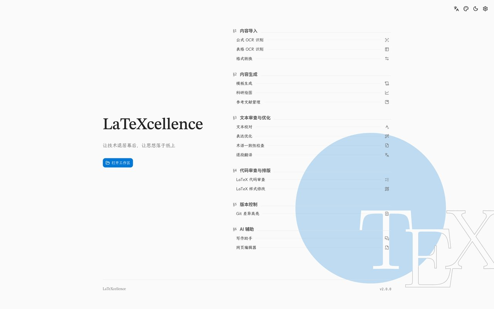</a></td>
    <td><a href="screenshots/1.jpg">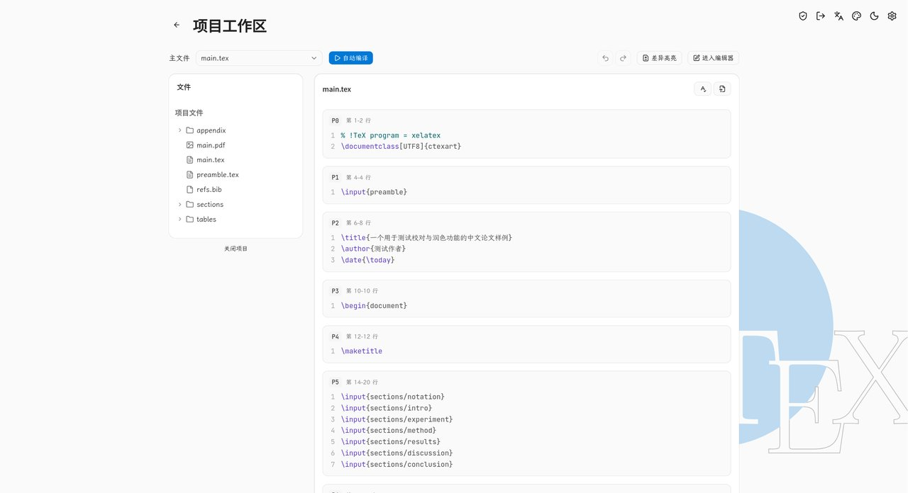</a></td>
    <td><a href="screenshots/2.jpg">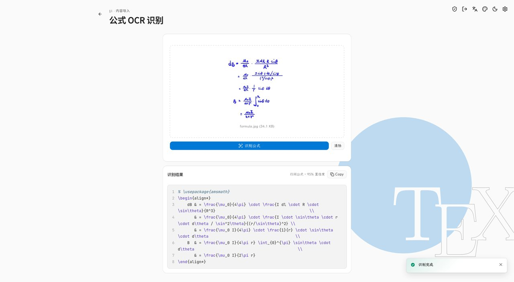</a></td>
    <td><a href="screenshots/3.jpg">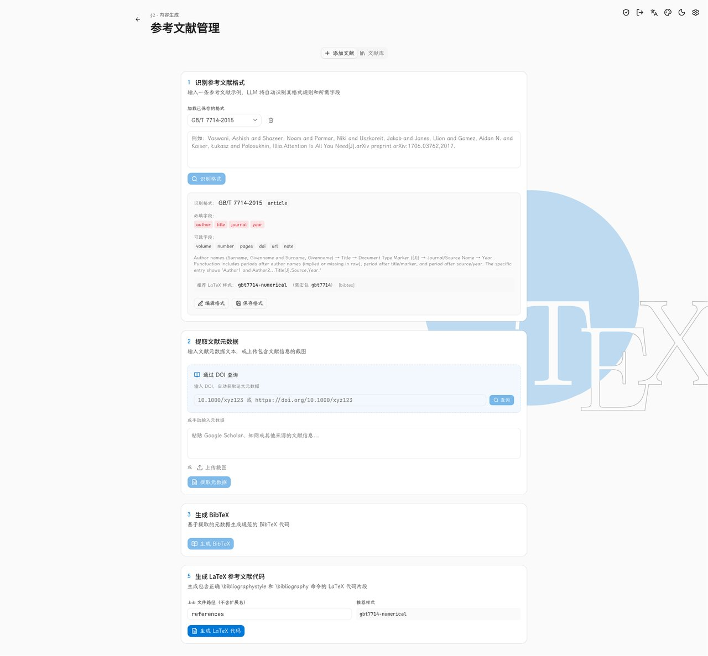</a></td>
    <td><a href="screenshots/4.jpg">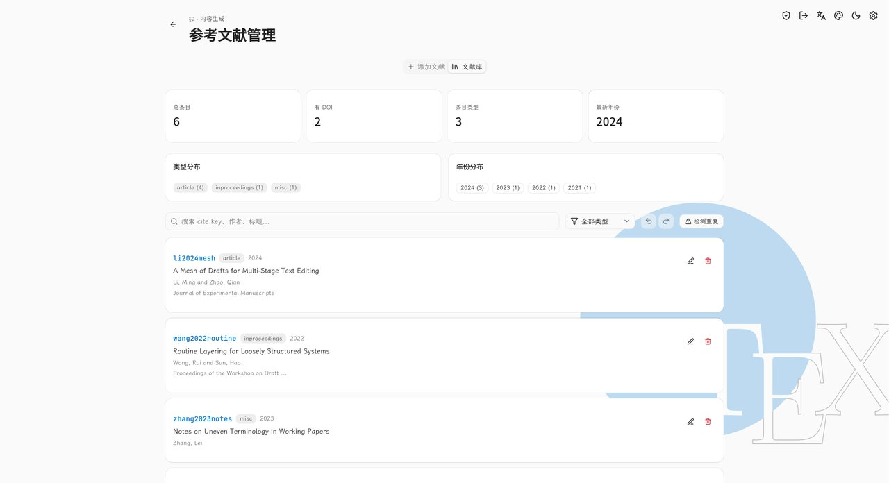</a></td>
    <td><a href="screenshots/5.jpg">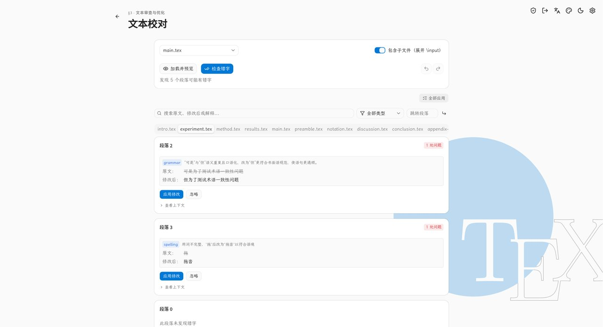</a></td>
    <td><a href="screenshots/6.jpg">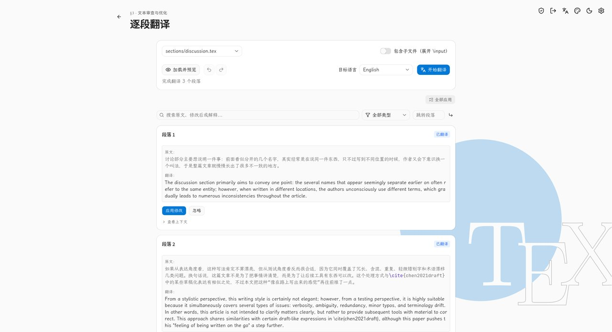</a></td>
    <td><a href="screenshots/7.jpg">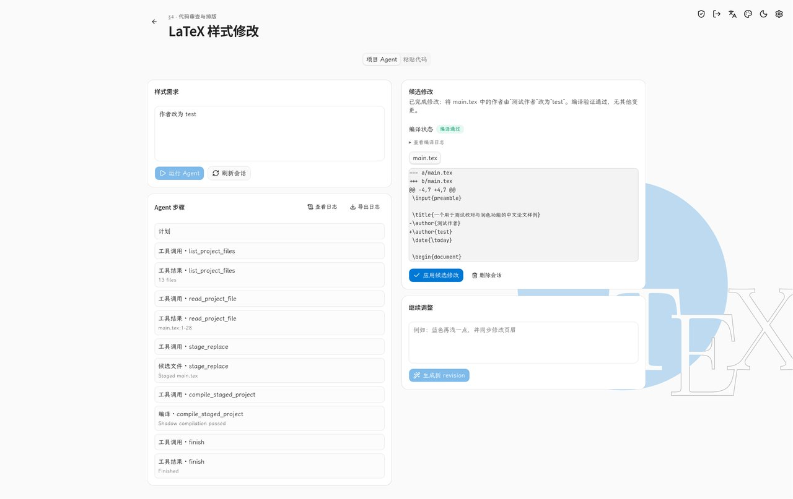</a></td>
    <td><a href="screenshots/8.jpg">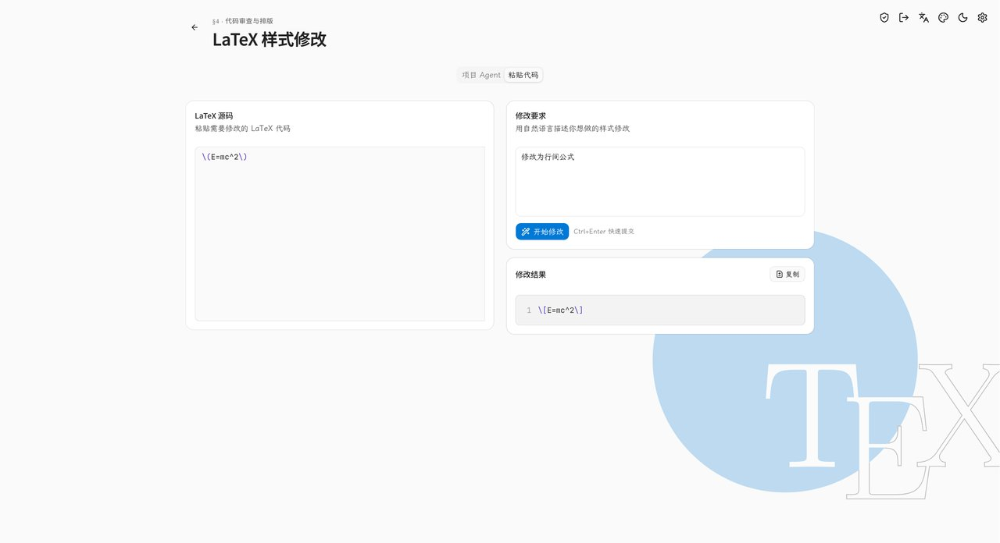</a></td>
    <td><a href="screenshots/9.jpg">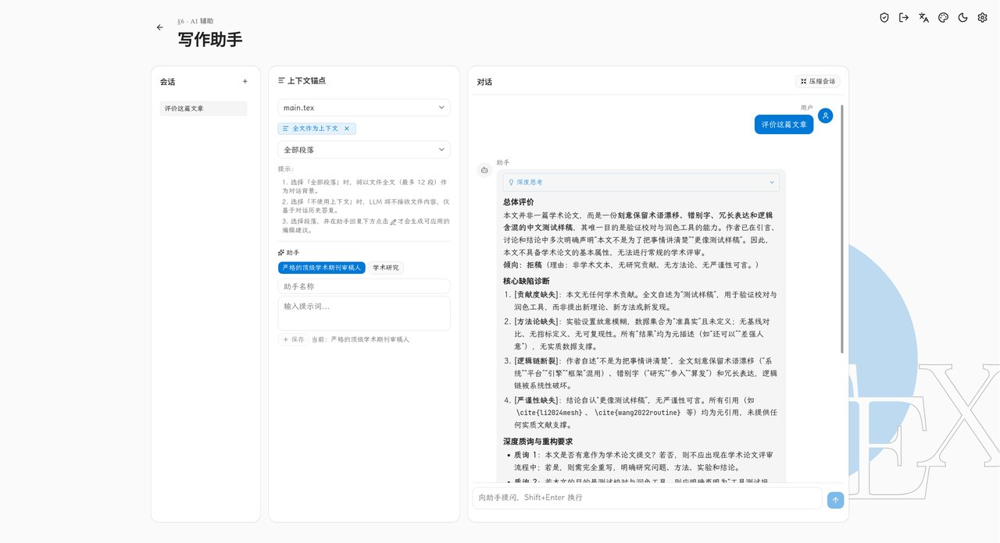</a></td>
    <td><a href="screenshots/10.jpg">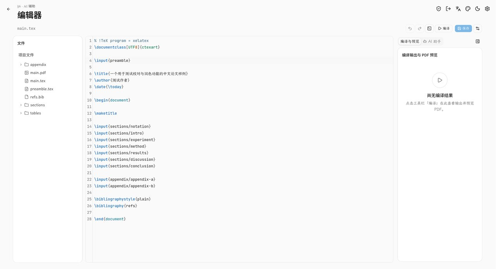</a></td>
    <td><a href="screenshots/11.jpg">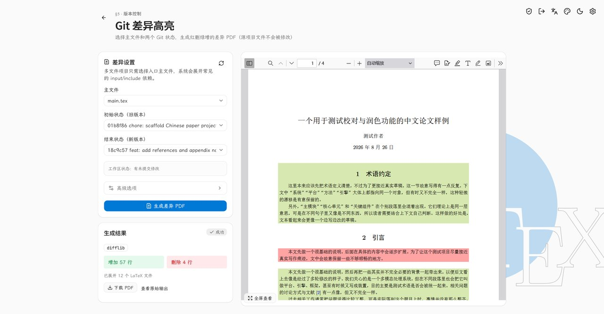</a></td>
    <td><a href="screenshots/12.jpg">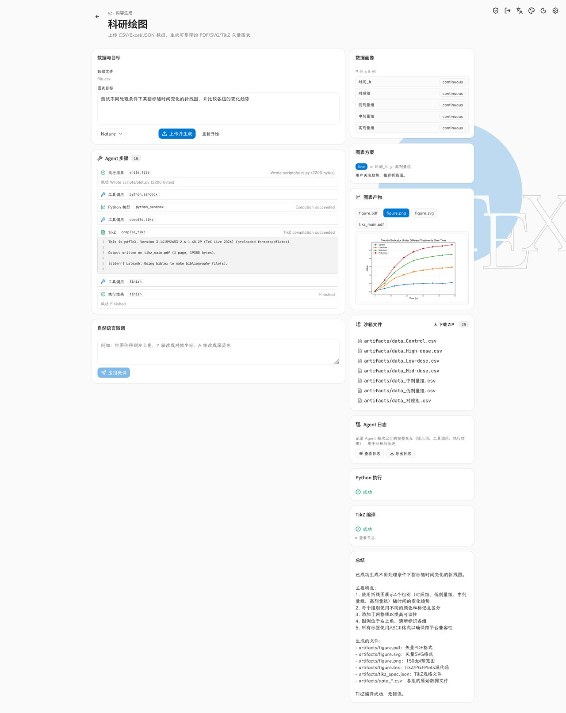</a></td>
    <td><a href="screenshots/13.jpg">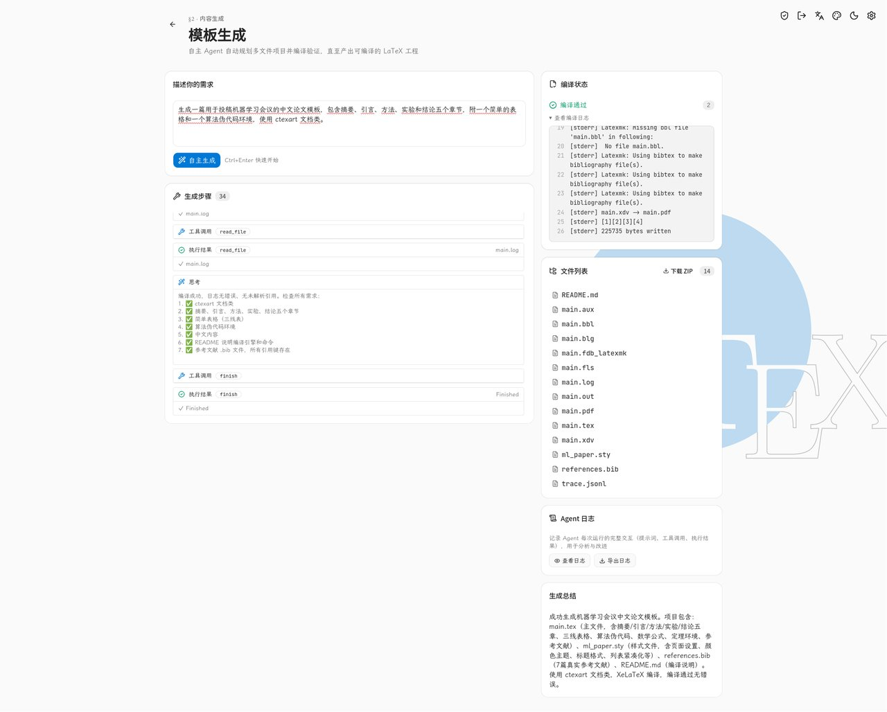</a></td>
    <td><a href="screenshots/14.jpg">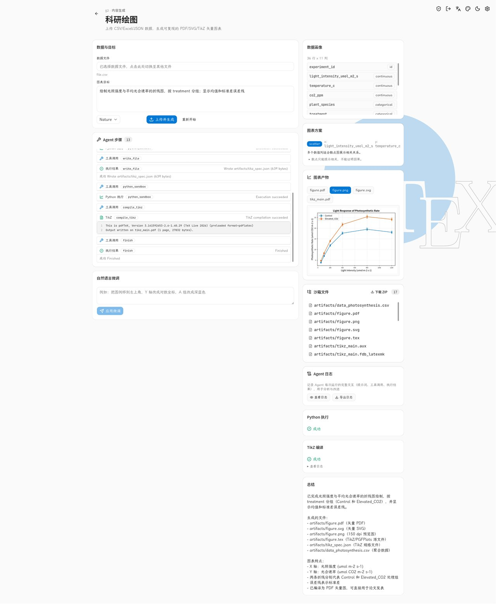</a></td>
  </tr>
</table>

## 校园应用价值

- **毕业论文季**：排版、校对、术语检查一站式完成，把“调格式”的时间还给内容本身
- **数学建模与课程报告**：模板生成 + 公式/表格识别解决“第一页写不出来”的入门门槛
- **LaTeX 教学辅助**：编译错误翻译让新手看得懂报错，天然适合作为课程辅助工具
- **效果可验证**：项目内置人工评测工具（错字、表达、术语、翻译、公式/表格 OCR、模板生成、科研绘图），可产出准确率与成功率报告，为智能体可靠性提供数据支撑

## 技术栈

| 层 | 技术 |
| --- | --- |
| 后端 | Python 3.12+, FastAPI, uvicorn, openai, pydantic v2, httpx |
| 前端 | React 19, Vite 6, Tailwind CSS 4, Zustand 5, shadcn/ui, sonner, react-markdown + KaTeX, highlight.js |
| 测试 | pytest + pytest-asyncio；前端 node:test（`npm test`，Node 内置测试运行器） |

## 快速开始

### 前置条件

- Python 3.12+
- Node.js 20+（仅构建前端时需要，见 `frontend/package.json` 的 `engines` 约束）
- texlive（含 xelatex、latexmk、latexindent、latexdiff，编译功能、LaTeX 代码审查功能、git diff 功能需要）
- Pandoc（Markdown 转 LaTeX 功能需要，[下载安装](https://pandoc.org/installing.html)）
- OpenAI API Key（或兼容的 API 端点）

### 安装

```bash
# 克隆项目
git clone https://github.com/eksisto/latexcellence.git latexcellence
cd latexcellence

# 建议使用虚拟环境，避免污染系统 Python
python -m venv .venv
source .venv/bin/activate
pip install -r requirements.txt

# 安装前端依赖
cd frontend
npm install
cd ..
```

### 配置

```bash
# 复制配置模板
cp config.example.json config.json
```

可以在 `config.json` 中填入 `api_key`，也可以使用环境变量 `LX_LLM_KEY`（推荐）。

环境变量 `LX_LLM_KEY` 优先级高于配置文件中的 `api_key`。SMTP 密码（`LATEXCELLENCE_SMTP_PASSWORD`）、Tavily 搜索 Key（`LATEXCELLENCE_TAVILY_API_KEY`）与学术数据源 Key（如 `LATEXCELLENCE_OPENALEX_API_KEY`）同理支持环境变量注入，且注入值永不写盘，完整清单见 [docs/deployment.md](docs/deployment.md)「环境变量参考」。

学术文献检索默认关闭。可在设置页启用各学术 Provider；默认数据源为 OpenAlex，也可填写对应 Provider 的 API Key。OpenAlex Key 可从 [OpenAlex 设置页](https://openalex.org/settings/api) 获取。

### 启动

**开发模式**（推荐）：

```bash
# 终端 1：启动后端
python main.py config.json

# 终端 2：启动前端
cd frontend
npm run dev
```

打开 http://localhost:5173

**生产模式**：

```bash
# 1. 将后端切换到生产模式（关闭 dev_mode 才会挂载 static/ 目录）
# 编辑 config.json，将 server.dev_mode 设为 false

# 2. 构建前端
cd frontend
npm run build
cd ..

# 3. 启动后端
python main.py config.json
```

打开 http://localhost:8000

**前后端分离部署（推荐公开访问方式）**：

前端只作为静态站点部署到服务器（如 `https://latexcellence.example.com`），用户自行下载并本地运行后端：

1. 构建前端并把产物部署到服务器：`cd frontend && npm run build`，将 `static/` 目录内容托管为静态站点。
2. 用户本地下载项目，在 `config.json` 中设置 `security.access_token`（随机长字符串），保持 `server.host` 为 `127.0.0.1`。
3. 后端在配置 `server.allowed_origins` 中加入前端域名（默认已含 `https://latexcellence.example.com`）。
4. 用户打开网站，在设置页填写后端地址（如 `http://localhost:8000/api`）和访问令牌，点击「测试连接」后即可使用。

> 维护者可在构建前把默认后端地址固化为自己的后端：复制 `frontend/.env.example` 为 `frontend/.env`，修改 `VITE_API_BASE_URL` 后重新 `npm run build`。这样用户打开前端即默认连接该地址，无需逐个在设置页填写（设置页仍可覆盖）。
>
> 若绑定的后端不可用或用户没有其账号（如多用户模式登录页），登录/注册页右上角的「后端连接设置」可改绑其他后端地址，保存后自动刷新并重新探测。

此模式下用户的 `.tex` 文件、TeX 工具链和 API Key 全部留在本地，前端服务器不接触用户数据；`/api/health` 保持公开以便连接测试，其余 `/api/*` 接口均校验访问令牌。

### 展示页（Showcase）

项目内置一个独立的展示页（`showcase/`），用于对外演示功能与设计：滚动叙述式（Scrollytelling）落地页，零依赖（Node.js 内置 `http` 静态服务器），内容由 `showcase/js/content.js` 数据驱动，主题 CSS 从 `frontend/src/theme/*.css` 自动生成。

点击前往展示页：https://show.latexcellence.example.com

```bash
cd showcase
npm start        # 或 node server.js
```

打开 http://127.0.0.1:4173。详见 [docs/showcase.md](docs/showcase.md)。

## 基本用法

1. 打开本地 LaTeX 项目目录
2. 选择 .tex 文件，系统解析段落
   - 开启 `包含子文件` 后，自动递归展开 `\input`/`\include` 引用的子文件
3. LLM 在纯文本上执行校对/优化
   - LaTeX 结构被替换为不可见的 marker，LLM 不能修改它们
4. 用户审核 diff 结果，逐项确认
5. 确认后，系统将 marker 还原为 LaTeX 并原子性写回源文件

## 项目结构

```
latexcellence/
├── main.py                  # 统一入口
├── config.json              # 配置文件
├── config.example.json      # 配置模板
├── docker-compose.yml       # 多实例编排（副本扩展 + 可选 Caddy 反代）
├── backend/
│   ├── core/                # 核心：配置、LLM 客户端、日志、工作区管理、项目管理
│   ├── modules/             # 各功能模块（路由 + 业务逻辑）
│   └── utils/               # 工具：文件操作、JSON 校验、LaTeX 解析等
├── docker/                  # 沙箱镜像体系（backend/tex/convert/plot + build.sh）
├── frontend/
│   └── src/                 # React 应用
├── showcase/                # 独立展示页（零依赖静态站，详见 docs/showcase.md）
├── screenshots/             # 项目截图（README / 文档配图）
├── data/                    # 应用运行期与用户数据（formats/ plots/ prompts/ style_modify_sessions/ templates/ writing_chat_sessions/）
├── tests/                   # 测试
├── tools/                   # 运维工具（compose-smoke.sh 多实例冒烟等）
├── docs/                    # 项目文档
└── clean-cache.sh / clean-cache.ps1  # 清理缓存脚本（Python/前端缓存）
```

## 维护

- `clean-cache.sh`（Windows 下可用 `clean-cache.ps1`）：清理 `__pycache__`、`.pytest_cache`、`.pytest_tmp`（pytest 会话级临时目录）、前端 `node_modules/.cache` 等缓存。

## 鸣谢

[THIRD_PARTY_NOTICES.md](THIRD_PARTY_NOTICES.md)，感谢这些开源项目的贡献者。
